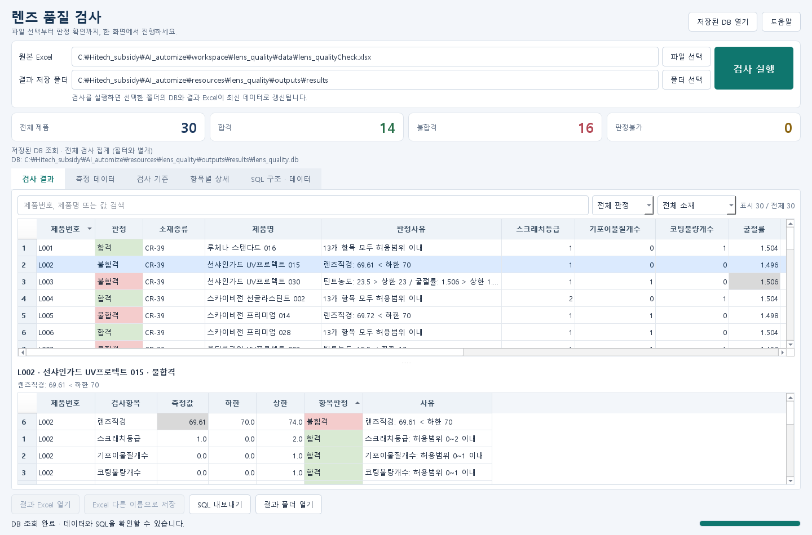

# 렌즈 검사 프로젝트

**Excel에 기록된 렌즈 측정값을 검사하고, 합격·불합격 결과와 그 이유를 보여주는 프로그램입니다.**

측정값을 검사 기준과 하나씩 비교하는 작업을 Python으로 처리하고, 결과를 Excel과 SQLite 데이터베이스에 저장합니다. 버튼과 표로 구성된 GUI 화면에서 검사 실행, 결과 확인, 데이터 조회와 내보내기를 할 수 있습니다.

QR 코드로 방문했다면 아래의 **실행 화면 → 판정 예시 → 단계별 제작 과정** 순서로 살펴보세요. 직접 사용하려면 [내 컴퓨터에서 실행하기](#내-컴퓨터에서-실행하기)를 따라 하면 됩니다. 이 프로그램은 PC에서 실행하는 Python 데스크톱 앱입니다.

> 제공된 제품 데이터와 검사 기준은 프로그램 개발 실습용입니다. 실제 품질 인증·출하 기준으로 검증된 값은 아니며, 경도지수는 검사 대상에서 제외했습니다.

## 프로그램으로 할 수 있는 일

- Excel의 측정값과 기준표를 읽어 제품을 검사합니다.
- 제품별 **합격·불합격·판정불가**와 항목별 사유를 확인합니다.
- 제품명 검색, 소재·판정 필터, 정렬로 원하는 데이터를 찾습니다.
- 검사 결과를 색상이 적용된 Excel 파일로 저장합니다.
- 저장된 DB를 다시 열거나 구조와 데이터를 SQL 파일로 내보냅니다.

### 실제 실행 화면



현재 프로그램에 저장된 샘플 DB를 불러온 화면입니다. 선택한 제품의 측정값과 불합격 사유를 함께 확인할 수 있습니다. [화면을 크게 보기](docs/images/gui-overview.png)

## 샘플로 이해하는 검사 결과

샘플은 **제품 30개, 제품당 검사 항목 13개**로 구성되어 있습니다. 소재는 CR-39, 하이인덱스, 폴리카보네이트 3종입니다.

| 전체 제품 | 합격 | 불합격 | 판정불가 |
|---:|---:|---:|---:|
| 30개 | 14개 | 16개 | 0개 |

위 수치는 제공된 원본과 기준을 사용한 예상 결과입니다. 측정값이나 기준을 바꾸면 결과도 달라집니다.

| 제품 | 판정 | 이유 |
|---|---|---|
| L001 | 합격 | 13개 항목이 모두 허용 범위 이내 |
| L002 | 불합격 | 렌즈직경이 69.61 mm로 하한 70 mm보다 작음 |

예를 들어 렌즈직경 기준은 **70~74 mm**입니다. 70 또는 74처럼 경계값과 같아도 해당 항목은 합격입니다. 제품에 불합격 항목이 하나라도 있으면 최종 불합격이며, 불합격 없이 측정값·기준 문제로 판단할 수 없는 항목이 있으면 최종 판정불가입니다.

## 데이터는 이렇게 이동합니다

```text
원본 Excel: 측정데이터 + 기준표
                ↓
       입력 확인 · 숫자 변환
                ↓
     SQLite DB에 입력 데이터 저장
                ↓
       SQL로 저장한 데이터 조회
                ↓
   Python 조건문으로 제품·항목별 판정
                ↓
         DB에 검사 결과 저장
                ↓
      결과 Excel 저장 · GUI에 표시
```

**Python**은 데이터를 읽고 판정하는 역할을, **SQL**은 DB에 저장된 데이터를 조회하는 역할을 합니다. **SQLite**는 표들을 하나의 `.db` 파일에 보관하는 데이터베이스입니다.

GUI의 **검사 실행**은 위 과정을 수행합니다. **저장된 DB 열기**는 이미 저장된 결과를 읽어 보여주는 기능입니다.

## 단계별 제작 과정

아래는 프로그램을 구성한 기능을 6단계로 나누어 정리한 제작 과정입니다. 각 단계의 관련 파일을 누르면 실제 코드를 볼 수 있습니다.

### 1단계 — Excel에 측정 데이터와 기준 준비

먼저 제품 정보, 측정값, 검사 기준을 일정한 표 형태로 정리했습니다. 기존 Excel 판정을 그대로 가져오지 않고, 측정값과 기준을 사용해 Python에서 다시 판정하도록 입력 범위를 정했습니다.

| 입력 시트 | 사용하는 범위 | 내용 |
|---|---|---|
| 측정데이터 | A:P, 1행은 컬럼명 | 제품 정보 3개 + 측정 항목 13개 |
| 기준표 | A:F, 컬럼명 아래 최대 15행 | 검사항목·적용소재·단위·하한·목표치·상한 |

기준은 **공통 12행 + 소재별 굴절률 3행**입니다. 목표치는 참고용으로 저장하며, 합격 여부는 하한과 상한으로 결정합니다. Q열 이후에 있는 원본의 기존 판정·사유·보조 계산은 검사 입력에 포함하지 않습니다.

관련 파일: [원본 Excel](data/lens_qualityCheck.xlsx) · [입력 명세](docs/database-spec.md)

### 2단계 — Excel 데이터를 Python과 DB로 연결

pandas의 `read_excel()`로 Excel을 읽어 **DataFrame이라는 메모리 안의 표**로 만들었습니다. 필수 컬럼, 중복 제품번호, 누락된 검사 항목, 숫자로 변환할 수 없는 값 등을 검사한 후 SQLite에 저장했습니다.

저장할 때는 `to_sql()`이 테이블 생성과 데이터 삽입을 처리합니다. 저장한 표를 SQL로 다시 조회하여 다음 판정 단계에서 사용합니다.

```python
measurements.to_sql("measurements", conn, if_exists="replace", index=False)
criteria.to_sql("criteria", conn, if_exists="replace", index=False)
```

위 코드는 검사 함수 안에서 사용하는 일부입니다. `measurements`에는 측정 데이터를, `criteria`에는 검사 기준을 저장합니다.

관련 파일: [Lens.py — 입력·DB 처리](Lens.py) · [테이블 구조](docs/schema.sql)

### 3단계 — 조건문으로 합격·불합격과 사유 계산

제품 하나를 선택하고, 그 제품의 13개 검사 항목을 반복해서 확인하도록 만들었습니다. 검사항목과 소재에 맞는 기준을 찾은 뒤 `check_value()`에서 측정값을 비교합니다.

```text
하한 ≤ 측정값 ≤ 상한  → 합격
측정값 < 하한         → 불합격
측정값 > 상한         → 불합격
측정값·적용 기준 문제 → 판정불가
```

숫자 비교에 앞서 입력 오류와 결측값을 확인합니다. 예를 들어 **필수 검사 항목 자체가 기준표에서 빠지면 검사를 중단**하고, 입력 검증을 통과한 제품의 **개별 측정값이 비어 있으면 해당 항목을 판정불가**로 기록합니다.

제품별 최종 판정과 함께 항목별 측정값·하한·상한·판정·사유를 남겨, 어떤 값 때문에 불합격했는지 확인할 수 있도록 했습니다. 30개 제품을 13개 항목으로 검사하므로 상세 결과는 **390행**입니다.

관련 파일: [Lens.py — 판정 함수](Lens.py) · [판정 규칙과 예외 처리](docs/database-spec.md)

### 4단계 — 결과 Excel과 색상 표시 만들기

검사 결과를 DB에 저장한 뒤, openpyxl을 이용해 결과 Excel에 색상을 적용했습니다.

| 표시 대상 | 색상 |
|---|---|
| 합격 판정 셀 | 연두색 |
| 불합격 판정 셀 | 분홍색 |
| 불합격을 일으킨 측정값 셀 | 회색 |

결과 Excel은 **검사결과**, **항목별상세**, **적용기준**의 3개 시트로 구성했습니다. 제품 전체 결과와 개별 항목의 근거를 함께 확인할 수 있습니다.

저장은 임시 Excel을 완성한 뒤 최종 파일로 교체하는 방식입니다. Excel 파일이 열려 있어 저장에 실패한 경우, 열려 있는 결과 Excel을 닫은 뒤 GUI에서 저장을 재시도하거나 다른 이름으로 저장할 수 있도록 했습니다.

관련 파일: [Lens.py — Excel 저장·서식 처리](Lens.py)

### 5단계 — DB 조회와 SQL 내보내기 추가

저장된 데이터를 검사 후에도 살펴볼 수 있도록 `view_db.py`를 만들었습니다. 측정값, 기준, 결과, 상세 데이터를 각각 조회하고, 브라우저에서 표로 확인하거나 터미널에 출력하도록 했습니다.

또한 `export_sql.py`에서 DB의 테이블 구조와 현재 데이터를 SQL 파일로 내보내도록 했습니다. SQL에는 입력 데이터뿐 아니라 검사 결과도 포함됩니다. 이 작업들은 새 검사와 별도로 실행합니다.

관련 파일: [view_db.py — 조회·도움말](view_db.py) · [export_sql.py — SQL 내보내기](export_sql.py)

### 6단계 — 버튼으로 사용하는 GUI 제작

PyQt6로 파일 선택, 검사 실행, 검색·필터·정렬, 제품별 상세 확인, Excel·SQL 내보내기를 연결했습니다.

검사 기능을 `run_inspection()` 같은 함수로 분리하여 터미널과 GUI가 같은 기능을 사용하도록 했습니다. `table_model.py`는 DataFrame의 값을 GUI 표에 표시하고 판정 색상을 제공하며, `gui.py`는 버튼과 기능을 연결합니다.

검사·DB 조회·내보내기는 작업 스레드에서 처리하고 진행 상태를 화면에 전달하도록 구성했습니다.

관련 파일: [gui.py — 화면과 버튼](gui.py) · [table_model.py — 표 표시](table_model.py)

## 내 컴퓨터에서 실행하기

아래는 **Windows PowerShell과 Python 3.10** 환경을 기준으로 한 실행 방법입니다. 프로젝트는 Python 3.10.11 환경에서 개발했습니다.

### 1. 프로젝트 폴더 열기

이 저장소를 다운로드하고 압축을 풉니다. VSCode에서 **`gui.py`와 `README.md`가 들어 있는 폴더**를 열고 터미널을 여세요.

원본 데이터는 `data/lens_qualityCheck.xlsx`입니다. 다른 컴퓨터에서 가져온 `.venv` 폴더를 사용하는 대신, 새 컴퓨터에서 가상환경을 만듭니다.

### 2. Python과 필요한 라이브러리 준비

Python 3.10이 설치된 상태에서 다음 명령을 한 줄씩 실행합니다.

```powershell
python --version
python -m venv .venv
.\.venv\Scripts\python.exe -m pip install -r requirements.txt
```

VSCode에서는 `Ctrl + Shift + P` → `Python: Select Interpreter` → `.venv\Scripts\python.exe`를 선택합니다.

아래 명령들은 가상환경 Python을 직접 지정하므로 PowerShell에서 가상환경을 별도로 활성화하지 않아도 됩니다. 전체 의존성을 기록된 버전으로 설치하려면 설치 명령에서 `requirements.txt` 대신 `requirements-lock.txt`를 사용합니다. 둘 다 설치할 필요는 없습니다.

### 3. GUI 열기

처음 사용하는 사람도 결과를 쉽게 찾을 수 있도록, 이 예시는 **프로젝트 안의 `results` 폴더**를 저장 위치로 지정합니다.

```powershell
.\.venv\Scripts\python.exe .\gui.py --output ".\results"
```

창이 열리면 다음 순서로 사용합니다.

1. 원본 Excel이 `data/lens_qualityCheck.xlsx`인지 확인합니다.
2. 결과 저장 폴더를 확인하거나 **폴더 선택**으로 변경합니다.
3. **검사 실행**을 누릅니다.
4. 결과표에서 판정과 사유를 확인합니다.
5. **결과 Excel 열기** 또는 **결과 폴더 열기**로 저장한 파일을 확인합니다.

나중에 같은 결과를 다시 보고 싶으면 **저장된 DB 열기**에서 `lens_quality.db`를 선택합니다. 새 검사를 시작하려면 원본 Excel과 결과 폴더를 확인한 뒤 **검사 실행**을 누릅니다.

## 생성되는 파일과 저장 위치

위 실행 예시에서는 검사 후 다음 두 파일이 만들어집니다.

```text
프로젝트 폴더/
└─ results/
   ├─ lens_inspection_result.xlsx
   └─ lens_quality.db
```

| 파일 | 저장 내용 |
|---|---|
| `lens_inspection_result.xlsx` | 검사결과·항목별상세·적용기준의 3개 시트 |
| `lens_quality.db` | 측정 데이터·검사 기준·제품별 결과·항목별 상세의 4개 테이블 |
| `lens_quality.sql` | **SQL 내보내기**를 별도로 실행했을 때 저장하는 구조와 데이터 |

같은 폴더에서 다시 검사하면 기존 DB의 4개 테이블과 결과 Excel을 최신 내용으로 갱신합니다. 이전 검사 이력을 누적하는 방식은 아닙니다.

DB 저장 후 Excel 저장만 실패할 수 있습니다. 오류가 표시되면 열려 있는 결과 Excel을 닫은 뒤 GUI의 **Excel 저장 다시 시도** 버튼을 누르세요. 저장할 파일 경로도 다시 선택할 수 있습니다. 이 기능은 해당 GUI 창에서 검사한 결과에 사용할 수 있으며, DB만 열어 조회한 상태에서는 사용할 수 없습니다.

## 사용한 기술

| 기술 | 프로젝트에서의 역할 |
|---|---|
| Python | 파일 읽기, 입력 검증, 조건문 판정, 저장 기능 연결 |
| pandas | Excel·SQL 데이터를 DataFrame 형태로 처리 |
| SQLite / SQL | 입력과 결과를 테이블로 저장하고 조회 |
| openpyxl | 결과 Excel 작성과 셀 색상 적용 |
| PyQt6 | 버튼·표·검색·필터가 있는 데스크톱 화면 구성 |
| HTML·CSS·JavaScript | 터미널 조회 결과를 브라우저용 표로 표시 |

`sqlite3`는 Python에 포함된 표준 라이브러리입니다. 별도 DB 서버를 설치하지 않고 사용합니다. 직접 사용하는 외부 라이브러리 버전은 [requirements.txt](requirements.txt)에 정리했습니다.

## 주요 파일 안내

| 파일 | 역할 |
|---|---|
| [gui.py](gui.py) | GUI를 여는 시작 파일. 사용자 동작과 기능을 연결 |
| [Lens.py](Lens.py) | Excel 입력 검증, 검사, DB·결과 Excel 저장 |
| [table_model.py](table_model.py) | GUI 표의 데이터·색상과 검색·필터·정렬 처리 |
| [view_db.py](view_db.py) | 터미널 도움말, DB 조회, HTML 생성, SQL 문장 확인 |
| [export_sql.py](export_sql.py) | DB 전체를 SQL 파일로 내보내기 |
| [data/lens_qualityCheck.xlsx](data/lens_qualityCheck.xlsx) | 샘플 측정값과 검사 기준 |
| [requirements.txt](requirements.txt) | 직접 사용하는 라이브러리와 버전 |
| [requirements-lock.txt](requirements-lock.txt) | 간접 의존성까지 포함한 라이브러리 버전 |

## 더 자세히 알아보기

- [데이터 흐름](docs/data-flow.md): 입력부터 검사·저장·조회·내보내기까지의 흐름도
- [데이터·DB 명세서](docs/database-spec.md): 컬럼·단위·기준값·판정 규칙·오류 처리
- [테이블 생성 SQL](docs/schema.sql): 데이터가 제외된 4개 테이블의 CREATE TABLE 정의

<details>
<summary><strong>터미널 명령과 도움말 보기</strong></summary>

### GUI에서 선택한 경로와 터미널의 기본 경로

`--output`을 생략한 GUI와 터미널의 `Lens.py`, `view_db.py`, `export_sql.py`는 코드에 지정된 기본 경로를 사용합니다. 기본 결과 폴더는 프로젝트 폴더 기준으로 다음 위치입니다.

```text
../../resources/lens_quality/outputs/results/
```

앞의 GUI 실행 예시에서 지정한 `.\results`와는 다른 위치입니다. **GUI에서 저장 폴더를 바꿔도 터미널 명령의 기본 경로가 바뀌지는 않습니다.** GUI에서 별도로 저장한 DB는 GUI의 **저장된 DB 열기**로 선택해 조회·내보내기하세요.

### 기본 경로로 검사·조회·내보내기

아래 명령은 프로젝트 폴더의 PowerShell에서 실행합니다.

```powershell
# 기본 경로로 검사하고 DB와 결과 Excel 저장
.\.venv\Scripts\python.exe .\Lens.py

# 기본 DB의 결과를 브라우저용 HTML로 조회
.\.venv\Scripts\python.exe .\view_db.py 결과

# 기본 DB의 기준을 터미널에서 조회
.\.venv\Scripts\python.exe .\view_db.py 기준 --터미널

# 결과 테이블의 CREATE TABLE 문장 확인
.\.venv\Scripts\python.exe .\view_db.py create 결과

# 기본 DB 전체를 SQL 파일로 내보내기
.\.venv\Scripts\python.exe .\export_sql.py
```

`view_db.py`의 일반 조회는 기본 결과 폴더의 `조회화면` 아래에 HTML을 생성합니다. `--터미널`은 터미널 출력만, `--열지않기`는 HTML 저장만 수행합니다. `create`, `insert`, `sql`은 SQL 문장을 보여 주는 명령이며 해당 문장을 실행하지 않습니다.

`export_sql.py`는 기본 DB와 같은 폴더에 `lens_quality.sql`을 저장합니다. 검사 실행만으로 HTML이나 SQL 파일이 만들어지지는 않습니다. DB를 갱신한 뒤에는 조회·내보내기를 다시 실행해야 최신 내용이 반영됩니다.

### 도움말

프로젝트 전체 사용법은 다음 명령으로 확인합니다.

```powershell
.\.venv\Scripts\python.exe .\view_db.py --help
```

`view_db.py`는 인수 생략, `help`, `도움말`, `-h`, `--help`의 다섯 방식으로 같은 도움말을 보여 줍니다. 다른 실행 파일은 다음처럼 확인합니다.

```powershell
.\.venv\Scripts\python.exe .\gui.py --help
.\.venv\Scripts\python.exe .\Lens.py --help
.\.venv\Scripts\python.exe .\export_sql.py --help
```

도움말은 검사·DB 조회·결과 저장을 시작하지 않습니다. 필요한 라이브러리는 설치되어 있어야 합니다. `gui.py`, `Lens.py`, `export_sql.py`를 인수 없이 실행하면 각각 GUI 열기, 검사, SQL 내보내기가 실행됩니다.

</details>
