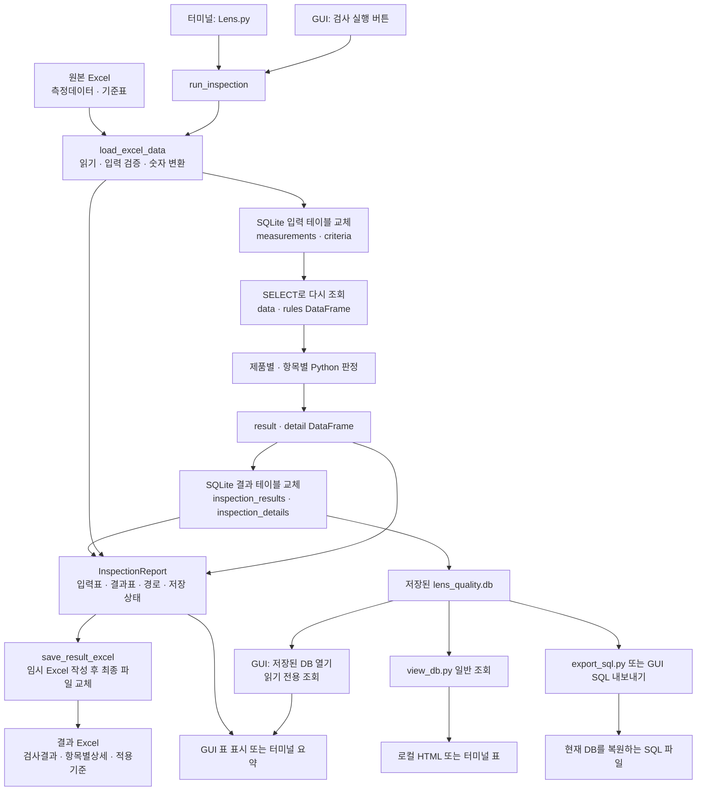

# 렌즈 품질 검사 데이터 흐름

| 항목 | 내용 |
|---|---|
| 문서 버전 | 2.0 |
| 확인일 | 2026-10-29 |
| 기준 코드 | Git 커밋 `50ed1c379945d9b2ab6c0c0233e3e9f2e4cccec3` |
| 관련 코드 | [Lens.py](../Lens.py), [gui.py](../gui.py), [table_model.py](../table_model.py), [view_db.py](../view_db.py), [export_sql.py](../export_sql.py) |
| 관련 문서 | [데이터·DB 명세서](database-spec.md), [테이블 생성 SQL](schema.sql), [프로젝트 안내](../README.md) |

이 프로그램은 Excel의 측정값과 검사 기준을 SQLite에 저장하고, Python 조건문으로 판정한 결과를 DB와 Excel에 저장한다. GUI와 터미널은 같은 검사 함수를 사용한다. 저장된 DB를 조회하거나 SQL로 내보내는 작업은 새 검사와 별도로 실행한다.

제품 데이터와 기준값은 프로그램 개발 실습용이다. 합격·불합격 사례가 섞이도록 조정한 값이며, 공인된 품질 인증·출하 기준이 아니다. 경도지수는 현재 검사 대상에 포함되지 않는다.

## 1. 전체 흐름



흐름도를 표시할 수 없는 환경에서는 다음 순서로 읽는다.

1. Excel에서 제품 정보·측정값과 검사 기준을 읽고 입력을 검증한다.
2. 입력 표를 SQLite의 `measurements`, `criteria` 테이블에 저장한다.
3. DB를 다시 조회한 뒤, 제품마다 13개 항목을 Python 조건문으로 판정한다.
4. 제품별 결과와 항목별 결과를 DB에 저장하고 결과 Excel을 만든다.
5. 필요할 때 GUI나 터미널에서 DB를 조회하거나 SQL 파일을 내보낸다.

**DataFrame은 실행 중 메모리에 있는 표이고, DB 테이블은 SQLite 파일에 저장된 표다.** 결과 Excel은 메모리에 있는 `result`, `detail`, `criteria`를 사용해 작성한다. Excel 저장을 위해 결과 테이블을 다시 조회하는 것은 아니다.

## 2. 기본 파일 위치와 GUI에서 선택한 위치

`BASE`는 현재 터미널의 위치가 아니라 `Lens.py`가 있는 폴더다. 현재 프로젝트 폴더는 `C:\Hitech_subsidy\AI_automize\workspace\lens_quality`이다.

| 구분 | 코드의 기본 경로 | 사용·생성 시점 |
|---|---|---|
| 원본 Excel | `BASE / "data" / "lens_qualityCheck.xlsx"` | 새 검사에서 읽음 |
| 결과 폴더 `RESULTS` | `BASE.parents[1] / "resources" / "lens_quality" / "outputs" / "results"` | 입력 검증 후 필요하면 생성 |
| DB `DB_FILE` | `RESULTS / "lens_quality.db"` | 검사 실행 시 생성·갱신 |
| 결과 Excel `OUTPUT` | `RESULTS / "lens_inspection_result.xlsx"` | DB 결과 저장 후 생성·갱신 |
| 조회 HTML | `DB_FILE.parent / "조회화면" / "<명령>.html"` | `view_db.py`의 일반 조회 시 생성·갱신 |
| SQL 파일 | `DB_FILE.with_suffix(".sql")` | `export_sql.py` 별도 실행 시 생성·갱신 |
| 구조 문서 | `docs/schema.sql` | 문서 작성 시 DB 구조를 기록 |

현재 기본 결과 폴더의 절대 경로는 다음과 같다.

```text
C:\Hitech_subsidy\AI_automize\resources\lens_quality\outputs\results
```

`BASE.parents[1]`은 프로젝트 폴더에서 두 단계 위인 `AI_automize`를 뜻한다. 프로젝트를 다른 위치로 옮기면 기본 결과 경로도 새 `BASE`를 기준으로 계산된다.

GUI에서는 원본 Excel과 결과 폴더를 변경할 수 있다. 검사를 실행하면 선택한 폴더에 `lens_quality.db`와 `lens_inspection_result.xlsx`가 저장된다. **GUI에서 바꾼 경로는 `Lens.py`, `view_db.py`, `export_sql.py`의 터미널 기본 경로를 바꾸지 않는다.**

GUI의 **저장된 DB 열기**로 선택한 DB는 조회·SQL 내보내기 대상이다. 이후 **검사 실행**을 누르면 GUI 상단에 지정된 원본 Excel과 결과 폴더를 사용한다. 선택한 DB의 데이터를 다시 판정하는 동작이 아니다.

## 3. 새 검사: Excel에서 결과 파일까지

### 3.1 Excel 읽기와 입력 검증

`run_inspection()`은 입력·출력 경로를 확인하고 `load_excel_data()`를 호출한다.

| 원본 시트 | 읽는 범위 | 반환 변수 | 현재 데이터 |
|---|---|---|---|
| `측정데이터` | A:P, 1행을 컬럼 이름으로 사용 | `measurements` | 30행 × 16열 |
| `기준표` | A:F, 컬럼 이름 아래 최대 15행 | `criteria` | 15행 × 6열 |

`측정데이터`의 A:P는 제품번호·소재종류·제품명과 13개 검사 항목이다. 오른쪽의 기존 판정·판정사유·이전 결과·항목별 수식은 입력 범위에 포함되지 않는다. 프로그램은 원본 Excel의 판정 수식을 복사해 사용하는 대신 Python으로 다시 판정한다.

입력 검증은 DB 연결과 저장 폴더 생성보다 먼저 수행한다.

| 확인 내용 | 현재 처리 |
|---|---|
| 필요한 시트·컬럼 존재 여부 | 없으면 오류로 중단 |
| 제품번호가 비어 있는 행 | 해당 행 제외 |
| 제외 후 제품이 하나도 없음 | 오류로 중단 |
| 제품번호 중복 | 오류로 중단 |
| 동일한 `검사항목 + 적용소재` 기준 중복 | 오류로 중단 |
| 검사항목 이름이 비어 있음 | 오류로 중단 |
| 필수 검사 항목 13개 중 항목 전체가 누락됨 | 오류로 중단 |
| 기준에 있는 검사 항목의 측정 컬럼이 없음 | 오류로 중단 |
| 측정값 또는 하한·목표치·상한에 숫자로 바꿀 수 없는 문자열이 있음 | 오류로 중단 |
| 개별 측정값·하한·상한이 비어 있음 | 입력을 통과할 수 있으며 항목 판정에서 `판정불가` 처리 |

필수 항목 전체가 사라진 경우와 특정 소재의 기준만 없는 경우는 다르다. 전자는 입력 단계에서 중단하고, 후자는 영향을 받는 제품의 해당 항목을 `판정불가`로 기록한다.

`items`는 기준표의 `검사항목`에서 중복을 제거한 목록이다. 현재 공통 기준 12행과 소재별 굴절률 기준 3행이 있으므로, 실제 검사 항목은 13개다. `목표치`도 숫자로 변환하지만 판정에는 하한·상한만 사용한다.

### 3.2 입력 데이터를 DB에 저장하고 다시 조회

`sqlite3.connect(db_path)`가 DB에 연결하며 파일이 없으면 생성한다. 다음 `to_sql()` 호출이 테이블 생성과 행 삽입을 수행한다.

```python
measurements.to_sql("measurements", conn, if_exists="replace", index=False)
criteria.to_sql("criteria", conn, if_exists="replace", index=False)
```

`if_exists="replace"`는 해당 이름의 테이블이 이미 있으면 교체한다는 뜻이다. `index=False`는 DataFrame의 행 인덱스를 DB 컬럼으로 저장하지 않는다는 뜻이며, 제품번호를 기본키로 지정하는 옵션은 아니다.

그다음 실제로 저장한 입력 테이블을 조회한다.

```sql
SELECT * FROM measurements ORDER BY "제품번호";
SELECT * FROM criteria;
```

조회 결과를 `data`, `rules`라는 DataFrame에 담아 Python 검사에 사용한다. 원본의 제품번호를 새로 매기지는 않는다. 제품별 결과의 순서는 제품번호 오름차순이다.

### 3.3 제품별·항목별 판정

바깥 반복문은 제품 하나를 가져오고, 안쪽 반복문은 그 제품의 검사 항목을 하나씩 처리한다.

```text
제품 하나 선택
  → 검사 항목 하나 선택
  → 항목명과 소재에 맞는 기준 찾기
  → 측정값을 하한·상한과 비교
  → 항목 결과와 사유 기록
  → 다음 항목 반복
  → 제품의 최종 판정 결정
다음 제품 반복
```

적용 기준은 다음 조건을 모두 만족하는 행이다.

```text
기준의 검사항목 = 현재 검사 항목
그리고
(적용소재 = "공통" 또는 적용소재 = 제품의 소재종류)
```

일치하는 기준이 정확히 1개일 때만 `matched.iloc[0]`으로 그 행을 가져온다. 0개이거나 2개 이상이면 `적용 기준 누락 또는 중복` 사유로 `판정불가`다. 공통 기준과 소재별 기준이 동시에 일치해도 소재별 기준을 자동으로 우선하지 않는다.

기준이 하나일 때 `check_value()`는 아래 순서로 판단한다.

| 조건 | 항목판정 |
|---|---|
| 측정값 누락 | 판정불가 |
| 하한 또는 상한 누락 | 판정불가 |
| 하한 > 상한 | 판정불가 |
| 측정값 < 하한 | 불합격 |
| 측정값 > 상한 | 불합격 |
| 하한 ≤ 측정값 ≤ 상한 | 합격 |

경계값은 합격에 포함한다. 판정 전에 별도로 반올림하거나 오차 허용폭을 더하지 않는다.

모든 항목을 확인한 뒤 제품의 최종 판정은 **불합격 → 판정불가 → 합격** 순으로 우선한다. 불합격 항목이 하나라도 있으면 최종 불합격이고, 불합격이 없으면서 판정불가 항목이 있으면 최종 판정불가다. 모든 항목이 합격이면 최종 합격이다.

`판정사유`는 불합격 사유와 판정불가 사유를 모아 줄바꿈으로 연결한다. 모든 항목이 합격이면 현재 데이터 기준 `13개 항목 모두 허용범위 이내`를 저장한다.

### 3.4 결과 저장과 반환

| 메모리의 표 | DB 테이블 | 결과 Excel 시트 | 현재 크기 |
|---|---|---|---|
| `measurements` | `measurements` | 별도 시트 없음 | 30행 × 16열 |
| `criteria` | `criteria` | `적용기준` | 15행 × 6열 |
| `result` | `inspection_results` | `검사결과` | 30행 × 18열 |
| `detail` | `inspection_details` | `항목별상세` | 390행 × 7열 |

`result`는 원래 제품 정보·측정값에 `판정`과 `판정사유`를 추가한 표다. `detail`은 제품 하나의 항목 하나당 한 행이므로 현재 30 × 13 = 390행이다. 각 컬럼의 정의와 기준값은 [데이터·DB 명세서](database-spec.md)에 정리했다.

결과 두 테이블도 `to_sql(if_exists="replace", index=False)`로 교체한다. DB 연결을 닫은 후 `InspectionReport`를 만들어 입력표·결과표, 판정 개수, 파일 경로와 Excel 저장 상태를 묶는다. 이 객체는 메모리에 있는 검사 보고서이며 다섯 번째 DB 테이블이 아니다.

`save_result_excel(report)`은 같은 출력 폴더 아래 임시 폴더에 Excel을 완성한 뒤, 최종 파일로 교체한다. 이때 다음 색상을 지정한다.

| 대상 | 색상 |
|---|---|
| `합격` 판정 셀 | 연두색 `D9EAD3` |
| `불합격` 판정 셀 | 분홍색 `F4CCCC` |
| 불합격을 일으킨 측정값 셀 | 회색 `D9D9D9` |

회색은 `검사결과`의 해당 제품·검사항목 셀과 `항목별상세`의 `측정값` 셀에 적용된다. `판정불가`에 별도의 배경색을 지정하는 코드는 없다.

## 4. GUI에서 검사·조회·저장을 연결하는 방법

### 4.1 버튼에서 함수까지

| 사용자 동작 | GUI 연결 | 실제 처리 |
|---|---|---|
| 검사 실행 | `start_inspection()` → `_start_task("inspect", ...)` | `run_inspection()` |
| 저장된 DB 열기 | `choose_database()` → `load_database()` → `_start_task("load", ...)` | `read_database()` |
| SQL 내보내기 | `choose_sql_export()` → `_start_task("sql", ...)` | `export_sql()` |
| Excel 다른 이름으로 저장 | `choose_excel_export()` → `_start_task("excel", ...)` | `save_result_excel()` |

`_start_task()`는 `BackgroundTask`를 만들고 `start()`를 호출한다. Qt가 작업 스레드에서 `BackgroundTask.run()`을 실행한다. 작업자는 결과·진행 상황·오류를 시그널로 전달하고, GUI 스레드가 표와 버튼을 갱신한다. 검사 중에는 다른 검사·파일 선택·내보내기가 겹치지 않도록 관련 버튼을 비활성화한다.

GUI를 처음 열 때는 자동 검사하지 않는다. 새 검사를 시작하면 이전 표시를 비우고 새 결과를 기다린다.

### 4.2 저장된 DB 열기는 조회만 수행

`read_database()`는 `mode=ro` 연결과 읽기 트랜잭션으로 네 테이블을 조회한다. 필요한 테이블·최소 컬럼이 있는지 확인한 뒤, DataFrame과 CREATE/INSERT 문장을 `DatabaseSnapshot`에 보관하고 DB 연결을 닫는다.

이 동작은 `run_inspection()`을 호출하지 않는다. 표에 합격·불합격이 바로 보이는 이유는 DB에 이미 저장된 판정을 읽었기 때문이다.

GUI 표는 읽기 전용이다. `table_model.py`는 DataFrame의 복사본에서 표시값·배경색을 제공하고, 검색·필터·정렬은 보이는 행과 순서만 바꾼다. 이 조작은 DB나 원본 Excel에 저장되지 않는다.

- 결과 탭은 판정·사유가 잘 보이도록 열 순서를 바꿔 표시한다. DB와 Excel의 컬럼 순서는 유지한다.
- 결과표에는 판정·소재 필터, 측정표에는 소재 필터, 상세표에는 판정 필터가 있다. 기준표에는 검색·정렬을 사용할 수 있다.
- 상단 합격·불합격 개수는 전체 결과 집계다. 필터로 보이는 행 수는 각 표의 `표시 / 전체`에서 확인한다.
- 다른 프로그램이 DB를 바꿔도 열린 표가 자동 갱신되지는 않는다. DB를 다시 열어야 최신 값이 보인다.
- 다른 DB를 여는 데 실패하면 이전 조회 화면을 유지한다.

### 4.3 Excel 저장 재시도와 SQL 내보내기의 차이

Excel 재저장은 **이 GUI 창에서 검사한 `InspectionReport`의 표**를 사용한다. 검사를 다시 하거나 DB를 다시 읽지 않는다. 파일이 열려 있어 저장에 실패했다면 결과 Excel을 닫거나 다른 이름을 골라 저장만 다시 시도할 수 있다.

DB 조회만 한 상태에서는 원본 Excel 경로나 Excel 저장 성공 여부를 추측하지 않는다. 이때 `report`가 없으므로 Excel 열기·저장 버튼은 비활성화된다.

SQL 내보내기는 **현재 화면이 조회한 DB 경로를 다시 열어** 그 시점의 DB 전체를 덤프한다. 화면의 검색·판정 필터나 SQL 미리보기에서 선택한 테이블로 범위를 제한하지 않는다. 표·SQL 미리보기는 조회 당시 내용이고, 내보내기는 재조회한 내용이므로 그사이에 DB가 바뀌면 내용이 달라질 수 있다.

## 5. HTML 조회와 SQL 파일

### 5.1 HTML은 view_db.py의 일반 조회에서 생성

`view_db.py 결과`, `기준`, `측정`, `상세`, `전체` 등은 기본 DB를 읽기 전용으로 조회한다. 기본 동작은 `조회화면/<명령>.html` 저장 후 연결 프로그램으로 여는 것이다.

`make_html()`이 표와 검색 기능을 HTML·CSS·JavaScript로 만든다. 합격·불합격 판정 셀에는 색상을 표시하지만, GUI·결과 Excel처럼 불합격 원인 측정값을 회색으로 표시하지는 않는다.

| 옵션·명령 | 결과 |
|---|---|
| 일반 조회, 표시 옵션 없음 | HTML 저장 후 자동 열기 시도 |
| `--터미널` 또는 `--text` | 터미널에 표 출력, HTML 생성 안 함 |
| `--열지않기` 또는 `--no-open` | HTML만 저장 |
| `create`, `insert`, `sql` | SQL 문장을 터미널에 출력, HTML 생성 안 함 |

HTML은 생성 당시 DB 내용을 담은 파일이다. DB가 갱신되어도 기존 HTML은 자동으로 바뀌지 않으므로 조회 명령을 다시 실행한다. GUI 표는 별도의 Qt 화면이며 HTML 파일을 생성하지 않는다.

### 5.2 SQL 문장 확인과 SQL 파일 내보내기

`view_db.py create`는 DB에 저장된 테이블 생성문을 보여 주고, `insert`는 현재 행을 복원할 수 있는 입력문을 보여 준다. `sql`은 둘 다 보여 준다. 이 명령은 SQL을 출력하며, 표시한 CREATE/INSERT 문을 실행하지 않는다.

`export_sql()`은 읽기 전용 DB 연결에서 `iterdump()`를 사용해 구조와 현재 데이터를 UTF-8 SQL 파일로 작성한다. 임시 파일을 완성한 후 최종 파일을 교체한다. SQL 파일에는 원본 측정값·검사 기준뿐 아니라 제품별·항목별 판정 결과도 포함된다. 과거에 실행한 SQL의 기록이나 Python 검사 코드가 들어가는 것은 아니다.

`docs/schema.sql`은 확인한 테이블 구조만 기록한 문서용 파일이다. INSERT 데이터는 없고, `Lens.py`도 이 파일을 실행하지 않는다. 실제 검사에서 테이블을 만드는 주체는 `to_sql()`이다.

## 6. 터미널 명령으로 실행하기

아래 명령은 프로젝트 폴더의 PowerShell에서 실행한다. 가상환경을 활성화했는지와 관계없이 프로젝트의 Python을 사용하도록 실행 파일을 직접 지정했다.

| 확인·실행할 기능 | 명령 |
|---|---|
| GUI 창 열기 | `.\.venv\Scripts\python.exe .\gui.py` |
| 기본 원본·기본 결과 폴더로 즉시 검사 | `.\.venv\Scripts\python.exe .\Lens.py` |
| 제품별 결과를 HTML로 조회 | `.\.venv\Scripts\python.exe .\view_db.py 결과` |
| 검사 기준을 HTML로 조회 | `.\.venv\Scripts\python.exe .\view_db.py 기준` |
| 네 테이블 모두 HTML로 조회 | `.\.venv\Scripts\python.exe .\view_db.py 전체` |
| 컬럼·자료형 등 구조 조회 | `.\.venv\Scripts\python.exe .\view_db.py 구조` |
| 결과를 터미널에 표시 | `.\.venv\Scripts\python.exe .\view_db.py 결과 --터미널` |
| HTML 저장만 수행 | `.\.venv\Scripts\python.exe .\view_db.py 결과 --열지않기` |
| 결과 테이블 CREATE 문 확인 | `.\.venv\Scripts\python.exe .\view_db.py create 결과` |
| 기준 테이블 INSERT 문 확인 | `.\.venv\Scripts\python.exe .\view_db.py insert 기준` |
| 네 테이블 CREATE·INSERT 확인 | `.\.venv\Scripts\python.exe .\view_db.py sql` |
| 기본 DB 전체를 SQL로 내보내기 | `.\.venv\Scripts\python.exe .\export_sql.py` |
| 프로젝트 전체 도움말 | `.\.venv\Scripts\python.exe .\view_db.py --help` |

GUI의 시작 경로를 지정하는 예시는 다음과 같다. 이 명령은 창을 열며, **검사 실행**을 눌러야 검사가 시작된다.

```powershell
.\.venv\Scripts\python.exe .\gui.py --input ".\data\lens_qualityCheck.xlsx" --output ".\results"
```

터미널의 `Lens.py`, `view_db.py`, `export_sql.py`에는 별도 입출력 경로를 지정하는 CLI 옵션이 없다. 기본 위치가 아닌 DB는 GUI의 **저장된 DB 열기**로 조회·내보내기할 수 있다. Python 코드에서 함수를 호출할 때는 `run_inspection(input_path, output_dir)`와 `export_sql(db_path, output_path)`에 경로를 전달할 수 있다.

`view_db.py`는 인수 생략, `help`, `도움말`, `-h`, `--help` 다섯 방식으로 같은 도움말을 출력한다. `gui.py`, `Lens.py`, `export_sql.py`의 도움말은 `-h` 또는 `--help`를 사용한다. 이 세 파일을 인수 없이 실행하면 각각 창 열기, 검사, SQL 내보내기가 실행된다.

도움말 요청은 검사·DB 조회·결과 저장·GUI/브라우저 열기를 실행하지 않는다. 필요한 라이브러리는 설치되어 있어야 한다. 각 파일을 다른 Python 코드에서 `import`하는 것만으로 검사·내보내기·GUI 실행이 시작되지도 않는다.

## 7. 오류가 발생했을 때 남을 수 있는 데이터

| 발생 시점 | 처리와 확인할 내용 |
|---|---|
| 입력 파일 경로·시트·컬럼·중복·숫자 검증 실패 | DB 저장 전에 중단한다. 이 실행으로 기존 결과를 교체하지 않는다. |
| 검사 항목의 값·적용 기준이 누락됨 | 입력 검증을 통과한 개별 항목은 `판정불가`와 사유로 저장될 수 있다. |
| DB 생성·테이블 저장 도중 오류 | 예외가 전달된다. 일부 테이블은 이미 갱신되었을 수 있다. |
| DB 저장 후 Excel 저장 중 `OSError` | `excel_saved=False`와 오류 내용을 담은 보고서를 반환한다. DB 저장은 완료된 상태다. |
| 터미널 검사에서 Excel 저장 실패 | DB 저장 완료와 Excel 오류를 출력하고 종료 코드 1로 끝난다. |
| GUI 검사에서 Excel 저장 실패 | 결과표를 표시하고 오류를 안내한다. 저장만 재시도할 수 있다. |
| SQL 내보내기 실패 | 예외를 전달한다. 임시 파일이 완성되지 않으면 기존 최종 SQL을 교체하지 않는다. |

`save_result_excel()`이 보고서 상태로 처리하는 오류는 `OSError` 계열이다. 다른 종류의 오류는 호출자에게 전달된다.

현재 코드는 DB 네 테이블과 Excel 파일을 하나의 작업 단위로 일괄 저장·롤백하지 않는다. 또한 pandas의 SQLite `to_sql()` 호출은 자체 저장 처리를 하므로, 바깥의 `with conn`만 보고 네 테이블 전체가 항상 함께 롤백된다고 해석하면 안 된다. DB 저장 중 오류가 발생했다면 테이블별 결과를 확인하고 입력·저장 문제를 해결한 뒤 검사를 다시 실행한다.

Excel은 임시 파일을 완성한 뒤 교체하므로 파일 잠금 등으로 교체에 실패했을 때 이전 Excel이 남을 수 있다. 이 경우 최신 DB와 이전 Excel이 서로 다른 검사 내용을 담을 수 있으므로 저장 성공 여부를 확인해야 한다.

## 8. 문서 유지관리 기준

현재 DB는 최신 결과를 저장하는 구조다. 검사 실행 번호·실행 시각·기준 버전 이력을 별도로 저장하지 않으며, 제품번호를 키로 강제하는 DB 제약조건도 없다. 상세한 한계와 실제 컬럼 정의는 [데이터·DB 명세서](database-spec.md)에 따른다.

다음이 변경되면 이 문서와 데이터·DB 명세서를 함께 갱신한다.

- 원본 Excel 시트·열 범위·필수 검사 항목
- 기준 선택 방식, 경계값 비교, 최종 판정 우선순위
- DB 테이블·컬럼, 결과 Excel 시트와 서식
- 기본 경로, GUI의 파일 선택·조회·저장 동작
- HTML·SQL 생성 방식과 도움말 명령

문서 재작성 과정에서는 코드를 실행해 결과를 덮어쓰지 않고, 소스와 기존 DB·Excel을 읽어 현재 동작을 확인한다. 이 문서의 행 수는 확인 당시 제공된 샘플의 크기이며 제품 수를 30개로 제한하는 코드 규칙은 아니다.
