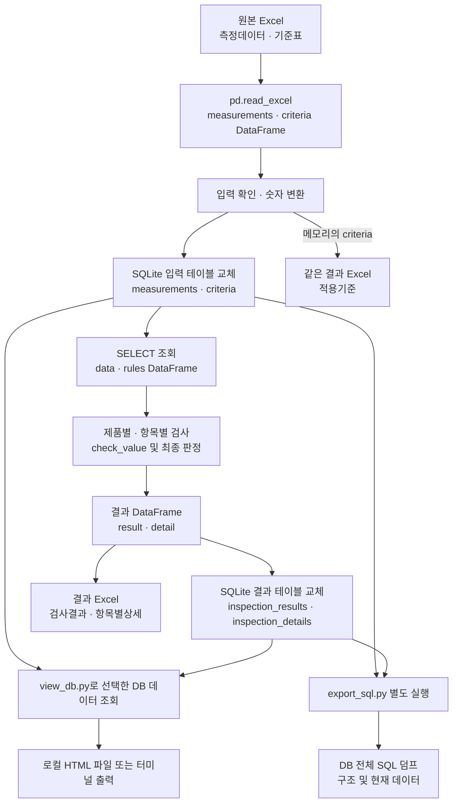

# 렌즈 품질 검사 데이터 흐름

- 문서 버전: 1.0
- 확인일: 2026-10-24
- 대상 코드: [Lens.py](../Lens.py), [view_db.py](../view_db.py), [export_sql.py](../export_sql.py)
- 관련 문서: [DB 명세서](database-spec.md), [테이블 생성문](schema.sql)

이 프로젝트는 원본 Excel의 측정값과 검사 기준을 SQLite에 저장한 다음, Python 조건문으로 제품별 판정을 계산한다. 판정 결과는 DB와 결과 Excel에 저장하며, 별도의 조회 프로그램으로 HTML 화면을 만들 수 있다.

기준값과 제품 데이터는 실습용이다. 합격·불합격 사례를 확인하기 위해 조정한 기준이며, 공인된 제품 품질 기준을 검증한 자료가 아니다. 이 문서는 현재 코드의 동작을 설명하며, 검사 기준의 적합성을 보증하지 않는다.

## 1. 전체 흐름



흐름도를 표시할 수 없는 환경에서는 다음 순서로 읽는다.

1. 원본 Excel을 `measurements`, `criteria`라는 메모리의 표(DataFrame)로 읽는다.
2. 입력을 확인하고 숫자를 변환한 뒤, SQLite의 `measurements`, `criteria` 테이블에 저장한다.
3. 두 테이블을 다시 조회하여 `data`, `rules`라는 DataFrame을 만든다.
4. 제품 하나의 각 항목을 검사하고, 모든 항목의 결과를 모아 제품의 최종 판정을 정한다.
5. 제품별 `result`와 항목별 `detail` DataFrame을 만들고, DB 결과 테이블과 Excel 시트로 각각 저장한다.
6. 필요할 때 `view_db.py`로 DB를 조회하거나 `export_sql.py`로 SQL 덤프를 만든다. 두 작업은 `Lens.py` 실행에 자동으로 포함되지 않는다.

**DataFrame은 프로그램 실행 중 메모리에 있는 표이며, DB 테이블은 SQLite 파일에 저장된 표다.** 이름이 같아도 별개다. 결과 Excel은 결과 DB 테이블을 다시 조회해서 만드는 것이 아니라, 메모리의 `result`, `detail`, `criteria`에서 작성한다.

## 2. 파일 위치

프로젝트 기준 폴더 `BASE`는 현재 터미널 위치가 아니라 `Lens.py`가 저장된 폴더다. 문서의 `OUTPUT_ROOT`는 코드의 `RESULTS`를 가리키는 설명용 이름이며, 코드에 정의된 별도 변수는 아니다.

| 구분 | 경로 또는 경로 계산식 | 생성·사용 주체 |
|---|---|---|
| 원본 Excel | `BASE / "data" / "lens_qualityCheck.xlsx"` | `Lens.py`가 읽음 |
| 결과 폴더 `OUTPUT_ROOT` | `BASE.parents[1] / "resources" / "lens_quality" / "outputs" / "results"` | `Lens.py`가 폴더 생성 |
| SQLite DB | `OUTPUT_ROOT / "lens_quality.db"` | `Lens.py`가 생성·갱신 |
| 결과 Excel | `OUTPUT_ROOT / "lens_inspection_result.xlsx"` | `Lens.py`가 생성·갱신 |
| 조회 HTML | `OUTPUT_ROOT / "조회화면" / "<명령>.html"` | `view_db.py`가 생성·갱신 |
| SQL 덤프 | `OUTPUT_ROOT / "lens_quality.sql"` | `export_sql.py`가 생성·갱신 |
| 문서용 테이블 구조 | 프로젝트의 `docs/schema.sql` | 문서 작성·갱신 시 DB에서 추출 |

현재 폴더 배치에서는 `BASE`가 `AI_automize/workspace/lens_quality`이고, 결과는 `AI_automize/resources/lens_quality/outputs/results`에 저장된다.

```text
AI_automize/
├─ workspace/
│  └─ lens_quality/                 ← BASE
│     ├─ Lens.py
│     ├─ view_db.py
│     ├─ export_sql.py
│     ├─ data/lens_qualityCheck.xlsx
│     └─ docs/
└─ resources/lens_quality/outputs/
   └─ results/                     ← OUTPUT_ROOT
      ├─ lens_quality.db
      ├─ lens_inspection_result.xlsx
      ├─ lens_quality.sql          ← SQL 내보내기 실행 시
      └─ 조회화면/                  ← HTML 조회 실행 시
         └─ 결과.html
```

프로젝트 폴더만 다른 위치로 옮기면 결과 경로는 새 `BASE`의 두 단계 위를 기준으로 계산된다. 현재 코드는 프로젝트 내부의 `results`에 저장하도록 변경되어 있지 않다. 다른 컴퓨터에서는 이 경로와 쓰기 권한을 확인해야 한다. `docs/schema.sql` 역시 `Lens.py` 실행만으로 자동 갱신되지 않는다.

## 3. 입력 읽기 및 확인

| Excel 시트 | 읽는 범위 | 저장 변수 | 처리 |
|---|---|---|---|
| 측정데이터 | A~P열, 제목 행 다음의 데이터 | `measurements` | 제품번호가 비어 있는 행 제거 |
| 기준표 | A~F열, 제목 행 다음의 최대 15개 데이터 행 | `criteria` | 공통 기준과 소재별 기준 읽기 |

`pd.read_excel()`의 기본 설정에 따라 첫 행을 컬럼 이름으로 사용한다. 측정데이터의 A~P에는 제품 정보와 측정값이 있으며, 그 뒤의 기존 Excel 판정·판정사유는 가져오지 않는다. 경도지수는 현재 검사 대상에 포함하지 않는다.

입력을 읽은 후 다음을 확인한다.

1. 측정데이터의 제품번호가 중복되면 오류로 중단한다.
2. 기준표에서 `검사항목`과 `적용소재`의 조합이 중복되면 오류로 중단한다.
3. 기준표의 `검사항목`에서 중복을 제거해 검사 목록 `items`를 만든다.
4. 각 검사 항목의 측정값과 기준표의 하한·목표치·상한을 `pd.to_numeric(..., errors="raise")`로 숫자로 변환한다. 변환할 수 없는 문자열은 오류를 발생시키며, 임의로 0으로 바꾸지 않는다.

현재 검사는 고정된 필수 항목 목록과 비교하지 않는다. **어떤 검사항목이 기준표에서 완전히 빠지면 `items`에도 포함되지 않아, 그 항목이 검사에서 빠질 수 있다.** 또한 기준표의 16번째 데이터 행부터는 현재 `nrows=15` 설정으로 읽지 않는다. 기준 항목을 추가하거나 삭제할 때는 코드의 읽기 범위와 검사 대상도 함께 확인해야 한다.

## 4. DB 저장 및 다시 조회

`sqlite3.connect(DB_FILE)`로 DB에 연결한다. DB 파일이 없으면 생성하며, `to_sql(..., if_exists="replace", index=False)`로 입력 테이블을 저장한다.

- `replace`: 같은 이름의 테이블을 제거하고 현재 데이터로 다시 만든다.
- `index=False`: pandas의 행 인덱스를 DB 컬럼으로 저장하지 않는다. 제품번호 컬럼은 저장한다.

이후 다음 SQL로 데이터를 다시 읽는다.

```sql
SELECT * FROM measurements ORDER BY "제품번호";
SELECT * FROM criteria;
```

조회 결과는 각각 `data`와 `rules` DataFrame에 저장된다. 제품은 제품번호 순서대로 검사한다. 현재 방식은 검사 실행 이력을 누적하지 않는다.

## 5. 항목별 검사와 제품별 최종 판정

바깥 반복문은 제품 한 행씩, 안쪽 반복문은 `items`의 검사 항목 하나씩 처리한다.

1. 현재 검사 항목이 같고, 적용소재가 `공통`이거나 제품 소재와 같은 기준을 `matched`로 고른다.
2. 해당 기준이 정확히 하나가 아니면 항목을 `판정불가`로 기록한다. 공통 기준과 소재별 기준이 동시에 일치해도 둘 중 하나를 우선 적용하지 않는다.
3. 기준이 하나라면 `matched.iloc[0]`으로 가져와 측정값·하한·상한을 `check_value()`에 전달한다.
4. 판정과 사유를 항목별 기록에 추가하고, 불합격·판정불가 사유는 제품별 목록에도 모은다.

`check_value()`는 아래 순서로 조건을 확인한다.

| 확인 조건 | 항목 판정 |
|---|---|
| 측정값 누락 | 판정불가 |
| 하한 또는 상한 누락 | 판정불가 |
| 하한이 상한보다 큼 | 판정불가 |
| 측정값이 하한보다 작음 | 불합격 |
| 측정값이 상한보다 큼 | 불합격 |
| 위 조건에 해당하지 않음 | 합격 |

하한과 상한의 경계값은 허용한다. 즉, `하한 ≤ 측정값 ≤ 상한`이면 합격이다. `목표치`는 저장하지만 현재 합격·불합격 계산에는 사용하지 않는다.

모든 항목의 검사가 끝나면 제품 최종 판정을 아래 우선순위로 정한다.

1. 불합격 항목이 하나 이상이면 `불합격`.
2. 불합격은 없고 판정불가 항목이 있으면 `판정불가`.
3. 모든 검사 항목이 합격이면 `합격`.

제품 판정사유는 불합격 사유와 판정불가 사유를 줄바꿈으로 연결한다. 문제 사유가 없으면 검사 항목 수와 함께 모두 허용범위 이내라는 문구를 저장한다. 항목별 결과에는 합격한 항목도 포함한다.

## 6. 검사 결과 저장 및 색상

| 메모리의 DataFrame | DB 테이블 | 결과 Excel 시트 |
|---|---|---|
| `result` | `inspection_results` | 검사결과 |
| `detail` | `inspection_details` | 항목별상세 |
| `criteria` | `criteria`에 앞 단계에서 저장 | 적용기준 |

결과 테이블 역시 `replace`로 교체한다. DB 저장 이후 `pd.ExcelWriter(..., engine="openpyxl")`로 Excel 한 파일에 세 시트를 작성한다. `with`의 들여쓰기 범위 안에서 시트 작성과 서식을 처리하고, 그 범위를 벗어나면서 파일을 저장하고 닫는다.

- 합격 판정 셀: 연두색 `#D9EAD3`
- 불합격 판정 셀: 분홍색 `#F4CCCC`
- 불합격 원인 측정값: 검사결과 시트의 해당 항목 셀과 항목별상세 시트의 측정값 셀에 회색 `#D9D9D9`
- 판정불가: 현재 별도 배경색을 지정하지 않음

원본 Excel은 수정하지 않는다. 결과 Excel은 같은 파일명으로 갱신하므로, Excel에서 결과 파일을 열어 둔 상태로 실행하면 저장 시 `PermissionError`가 발생할 수 있다. DB 저장과 Excel 저장은 하나의 일괄 트랜잭션이 아니므로, Excel 저장에 실패해도 DB는 이미 갱신되었을 수 있다.

## 7. HTML 조회와 SQL 내보내기

아래 명령은 `Lens.py`가 있는 프로젝트 폴더의 PowerShell에서 실행하는 예시다. `python`이 해당 프로젝트의 라이브러리가 설치된 Python을 가리켜야 한다.

```powershell
python .\Lens.py
python .\view_db.py --help
python .\view_db.py 결과
python .\view_db.py 전체 --열지않기
python .\view_db.py 기준 --터미널
python .\view_db.py create
python .\export_sql.py
```

### `view_db.py`

데이터 조회와 SQL 확인에는 DB가 먼저 생성되어 있어야 하며, 조회 시 DB를 읽기 전용으로 연다. 도움말은 DB가 없어도 볼 수 있다. 아래 다섯 명령은 같은 도움말을 표시하고 종료하며, DB 조회·파일 생성·브라우저 열기를 실행하지 않는다.

```powershell
python .\view_db.py --help
python .\view_db.py -h
python .\view_db.py
python .\view_db.py help
python .\view_db.py 도움말
```

도움말에는 검사 실행, 조회 명령과 표시 옵션, SQL 확인·내보내기 예시, 현재 설정에서 계산한 입력·출력 경로가 포함된다. 필요한 라이브러리는 설치되어 있어야 하며, 가상환경을 명시하려면 `python` 대신 `.\.venv\Scripts\python.exe`를 사용한다.

| 명령·옵션 | 동작 |
|---|---|
| `측정`, `기준`, `결과`, `상세` | 해당 DB 테이블 조회 |
| `불합격` | 제품별 최종 판정이 불합격인 행 조회 |
| `전체` | 네 테이블 모두 조회 |
| `테이블`, `구조` | 테이블 목록 또는 컬럼 구조 조회 |
| 일반 조회의 기본 동작 | `조회화면/<명령>.html`을 저장하고 연결된 브라우저 등으로 열기 |
| `--열지않기` / `--no-open` | HTML을 저장하되 자동으로 열지 않기 |
| `--터미널` / `--text` | HTML을 생성하지 않고 터미널에 표 출력 |
| `create`, `insert`, `sql` | 테이블 생성문, 현재 데이터의 INSERT 문, 또는 둘 모두를 터미널에 출력 |

SQL 확인 명령 뒤에 `측정`, `기준`, `결과`, `상세` 또는 실제 테이블 이름을 입력하면 대상을 제한한다. 예를 들어 `python .\view_db.py create 결과`는 `inspection_results`의 생성문만 출력하며, 대상을 생략하면 네 테이블 모두를 출력한다. 출력한 SQL을 실행하여 DB를 변경하는 기능은 아니다.

HTML은 조회 시점의 데이터를 담은 로컬 파일이다. 웹 서버에 업로드하거나 DB에 실시간 연결하지 않으며, DB를 갱신한 뒤 조회 명령을 다시 실행해야 최신 내용이 반영된다. HTML에는 검색·가로 스크롤·판정 색상 기능이 있지만, Excel의 불합격 원인 측정값 회색 표시는 구현되어 있지 않다.

### `export_sql.py`

기존 DB를 읽기 전용으로 열고 `conn.iterdump()` 결과를 `lens_quality.sql`에 저장한다. 네 테이블을 포함한 DB 전체 구조와 현재 데이터가 대상이므로, 입력 데이터뿐 아니라 판정 결과도 내보낸다. 원본 실행 과정의 SQL 로그나 Python 판정 로직을 저장하는 기능은 아니다.

문서의 `docs/schema.sql`은 테이블 구조만 정리한 파일이다. 데이터까지 포함하는 `export_sql.py`의 출력과 목적·저장 위치가 다르다.

## 8. 오류 처리와 현재 범위

| 상황 | 현재 동작 |
|---|---|
| 원본 파일 없음·시트 이름 불일치 | Excel 읽기 단계에서 오류로 중단 |
| 제품번호가 비어 있는 행 | 읽은 측정데이터에서 해당 행 제외 |
| 제품번호 또는 항목·소재 기준 중복 | 검증 단계에서 오류로 중단 |
| 읽은 검사 항목에 대응하는 측정 컬럼 없음 | 컬럼 접근 시 오류로 중단 |
| 숫자로 바꿀 수 없는 문자열 | 숫자 변환 단계에서 오류로 중단 |
| 검사 대상 측정값이 비어 있음 | 항목 판정불가 |
| 항목은 있으나 해당 제품에 적용할 기준이 0개 또는 여러 개 | 항목 판정불가 |
| 기준표에서 항목 자체가 완전히 제외됨 | 검사 목록에서도 제외될 수 있음 |
| 결과 Excel 저장 실패 | 실행 중단. DB는 이미 갱신되었을 수 있음 |
| DB 갱신 후 기존 HTML·SQL 파일을 그대로 열기 | 마지막 조회·내보내기 시점의 내용이 표시됨 |

프로젝트 내부 결과 폴더 사용, 필수 검사 항목의 고정 목록 검증, 검사 이력 누적, DB와 Excel 저장의 일관성 관리는 향후 개선 대상이다. 이 문서에서는 해당 기능이 이미 구현된 것으로 가정하지 않는다.
